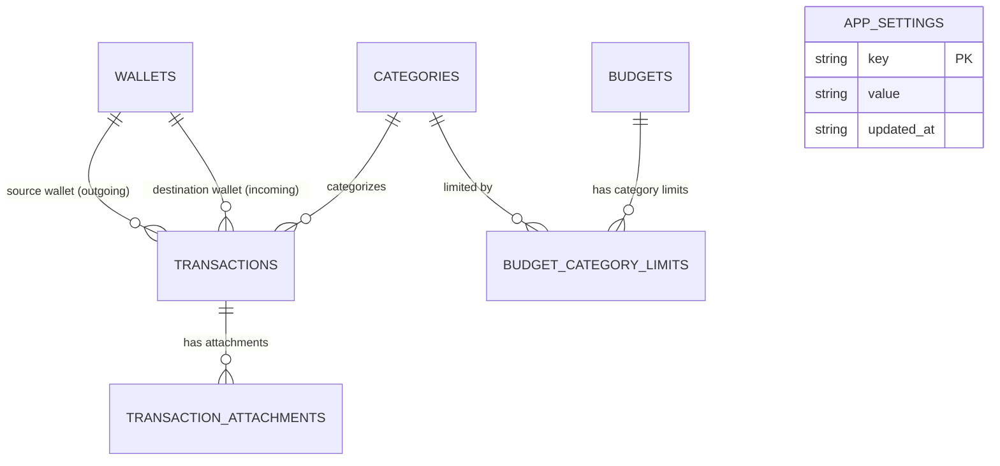
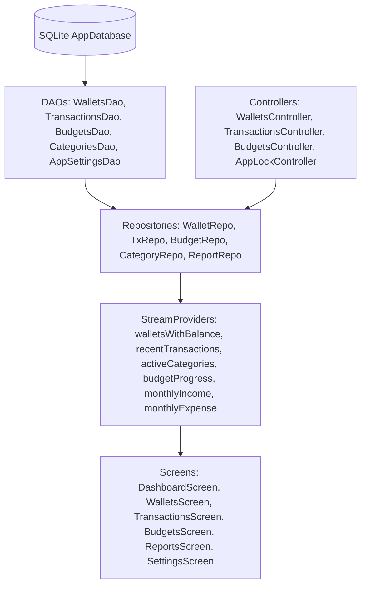

# DATABASE AUDIT — MYFINANCE FLUTTER APPLICATION
**Tanggal Audit:** 23 November 2026  
**Status Audit:** Complete  
**Tujuan:** Audit teknis menyeluruh terhadap arsitektur basis data, skema, model, query, repositori, dependensi fitur, dan logika kalkulasi lokal sebelum migrasi ke Supabase Cloud PostgreSQL.

---

## 1. Arsitektur Basis Data & Paket yang Digunakan

### 1.1 Mesin Database (Engine)
- **Native (iOS, Android, macOS, Desktop):** SQLite 3 via paket `sqlite3_flutter_libs` yang dikompilasi secara native untuk arsitektur ARM64 / x86_64.
  - Jalur Berkas: `getApplicationDocumentsDirectory() / AppConstants.databaseName` (`myfinance.sqlite`).
  - Eksekutor: `NativeDatabase.createInBackground(file)`.
  - Konfigurasi Ekstra: `PRAGMA foreign_keys = ON;` ditegakkan pada setiap pembukaan koneksi.
- **Web (Browser Chrome / Safari iOS):** SQLite via WebAssembly (WASM) menggunakan `sql-wasm.js` dan `sql-wasm.wasm`.
  - Lapisan Penyimpanan: `ResilientWebStorage` (wrapper berbasis `DriftWebStorage.indexedDb('myfinance_db', migrateFromLocalStorage: true)` dengan fallback volatile memori untuk mengantisipasi blokir IndexedDB pada mode penyamaran/Private Browsing Safari).

### 1.2 Paket Dependensi Basis Data (`pubspec.yaml`)
- `drift: ^2.18.0`: Object-Relational Mapping (ORM) utama, type-safe query builder, mekanisme DAO, reaktifitas `Stream` via table watchers, dan pengelola migrasi.
- `sqlite3_flutter_libs: ^0.5.24`: Pustaka biner SQLite C untuk platform native.
- `path_provider: ^2.1.3`: Penentu direktori sandboxed sistem operasi (`ApplicationDocumentsDirectory`).
- `path: ^1.9.0`: Utilitas manipulasi path berkas lintas platform.
- `drift_dev: ^2.18.0` *(dev_dependencies)*: Generator kode Drift untuk menghasilkan `app_database.g.dart` dan DAO mixins.
- `build_runner: ^2.4.9` *(dev_dependencies)*: Eksekutor kompilasi generator Dart.

---

## 2. Skema & Spesifikasi Tabel Basis Data

Aplikasi MyFinance berjalan pada **Schema Version 2**. Seluruh tabel menggunakan UUID v4 (`TEXT`) sebagai primary key (kecuali tabel pengaturan yang menggunakan `key`).



### 2.1 Tabel `wallets`
Menyimpan akun keuangan pengguna (rekening bank, kas tunai, e-wallet, investasi).

| Nama Kolom | Tipe Data SQLite | Tipe Data Dart | Nullable | Default | Keterangan |
| :--- | :--- | :--- | :--- | :--- | :--- |
| `id` | `TEXT` | `String` | No | - | Primary Key (UUID v4) |
| `name` | `TEXT` | `String` | No | - | Nama dompet (panjang 1–100 karakter) |
| `type` | `TEXT` | `String` | No | - | Tipe: `'cash'`, `'bank'`, `'e_wallet'`, `'other'` |
| `opening_balance` | `INTEGER` | `int` | No | - | Saldo awal buku kas (satuan Rupiah penuh) |
| `opening_date` | `TEXT` | `String` | No | - | Tanggal saldo awal (ISO-8601 UTC) |
| `currency_code` | `TEXT` | `String` | No | `'IDR'` | Kode mata uang 3 karakter |
| `icon_key` | `TEXT` | `String` | Yes | `NULL` | Kunci ikon visual sistem (`AppIcons`) |
| `color_hex` | `TEXT` | `String` | Yes | `NULL` | Kode hex warna aksen dompet (cth: `'0xFF0E7A4A'`) |
| `is_archived` | `INTEGER` | `bool` | No | `FALSE` | Status arsip dompet cadangan |
| `created_at` | `TEXT` | `String` | No | - | Waktu pembuatan (ISO-8601 UTC) |
| `updated_at` | `TEXT` | `String` | No | - | Waktu pembaruan terakhir (ISO-8601 UTC) |

- **Primary Key:** `(id)`
- **Foreign Keys:** Tidak ada
- **Indeks:** Primary key index bawaan SQLite

---

### 2.2 Tabel `categories`
Menyimpan klasifikasi pos transaksi (pemasukan dan pengeluaran).

| Nama Kolom | Tipe Data SQLite | Tipe Data Dart | Nullable | Default | Keterangan |
| :--- | :--- | :--- | :--- | :--- | :--- |
| `id` | `TEXT` | `String` | No | - | Primary Key (UUID v4 / ID sistem `cat-*`) |
| `name` | `TEXT` | `String` | No | - | Nama kategori (panjang 1–100 karakter) |
| `type` | `TEXT` | `String` | No | - | Jenis: `'income'` atau `'expense'` |
| `icon_key` | `TEXT` | `String` | Yes | `NULL` | Kunci ikon kategori |
| `color_hex` | `TEXT` | `String` | Yes | `NULL` | Warna aksen kategori |
| `is_system` | `INTEGER` | `bool` | No | `FALSE` | Penanda kategori bawaan sistem |
| `is_archived` | `INTEGER` | `bool` | No | `FALSE` | Status arsip kategori kustom |
| `sort_order` | `INTEGER` | `int` | No | `0` | Urutan penataan tampilan antarmuka |

- **Primary Key:** `(id)`
- **Foreign Keys:** Tidak ada
- **Indeks:** Primary key index bawaan SQLite

---

### 2.3 Tabel `transactions`
Menyimpan buku besar mutasi transaksi (pemasukan, pengeluaran, transfer).

| Nama Kolom | Tipe Data SQLite | Tipe Data Dart | Nullable | Default | Keterangan |
| :--- | :--- | :--- | :--- | :--- | :--- |
| `id` | `TEXT` | `String` | No | - | Primary Key (UUID v4) |
| `type` | `TEXT` | `String` | No | - | Tipe: `'income'`, `'expense'`, `'transfer'` |
| `amount` | `INTEGER` | `int` | No | - | Nominal transaksi (harus > 0, Rupiah) |
| `occurred_at` | `TEXT` | `String` | No | - | Tanggal kejadian transaksi (ISO-8601 UTC) |
| `wallet_id` | `TEXT` | `String` | Yes | `NULL` | Foreign Key ke `wallets(id)` (sumber dana) |
| `destination_wallet_id`| `TEXT` | `String` | Yes | `NULL` | Foreign Key ke `wallets(id)` (khusus transfer) |
| `category_id` | `TEXT` | `String` | Yes | `NULL` | Foreign Key ke `categories(id)` |
| `merchant` | `TEXT` | `String` | Yes | `NULL` | Nama toko / vendor / rekanan bisnis |
| `description` | `TEXT` | `String` | Yes | `NULL` | Keterangan singkat transaksi |
| `notes` | `TEXT` | `String` | Yes | `NULL` | Catatan rinci (termasuk rincian item struk) |
| `source` | `TEXT` | `String` | No | `'manual'` | Sumber: `'manual'`, `'receipt_scan'`, `'recurring'` |
| `status` | `TEXT` | `String` | No | `'confirmed'`| Status: `'confirmed'`, `'voided'` |
| `created_at` | `TEXT` | `String` | No | - | Waktu pencatatan sistem (ISO-8601 UTC) |
| `updated_at` | `TEXT` | `String` | No | - | Waktu pembaruan sistem (ISO-8601 UTC) |

- **Primary Key:** `(id)`
- **Foreign Keys:**
  - `wallet_id` REFERENCES `wallets(id)` (RESTRICT / NO ACTION)
  - `destination_wallet_id` REFERENCES `wallets(id)` (RESTRICT / NO ACTION)
  - `category_id` REFERENCES `categories(id)` (RESTRICT / NO ACTION)
- **Indeks Tambahan:**
  1. `idx_transactions_occurred_at` ON `transactions(occurred_at)`
  2. `idx_transactions_type_status_occurred_at` ON `transactions(type, status, occurred_at)`
  3. `idx_transactions_wallet_occurred_at` ON `transactions(wallet_id, occurred_at)`
  4. `idx_transactions_category_occurred_at` ON `transactions(category_id, occurred_at)`

---

### 2.4 Tabel `transaction_attachments`
Menyimpan relasi lampiran foto struk belanja untuk transaksi terkait.

| Nama Kolom | Tipe Data SQLite | Tipe Data Dart | Nullable | Default | Keterangan |
| :--- | :--- | :--- | :--- | :--- | :--- |
| `id` | `TEXT` | `String` | No | - | Primary Key (UUID v4) |
| `transaction_id` | `TEXT` | `String` | No | - | Foreign Key ke `transactions(id)` |
| `local_path` | `TEXT` | `String` | No | - | Path relatif sandboxed (cth: `'receipts/<id>.jpg'`) |
| `mime_type` | `TEXT` | `String` | No | `'image/jpeg'` | Tipe MIME media |
| `file_size` | `INTEGER` | `int` | No | - | Ukuran berkas dalam bytes |
| `created_at` | `TEXT` | `String` | No | - | Waktu penyimpanan berkas (ISO-8601 UTC) |

- **Primary Key:** `(id)`
- **Foreign Keys:**
  - `transaction_id` REFERENCES `transactions(id)` **ON DELETE CASCADE**
- **Indeks Tambahan:**
  1. `idx_attachments_transaction_id` ON `transaction_attachments(transaction_id)`

---

### 2.5 Tabel `budgets`
Menyimpan batas anggaran belanja bulanan master.

| Nama Kolom | Tipe Data SQLite | Tipe Data Dart | Nullable | Default | Keterangan |
| :--- | :--- | :--- | :--- | :--- | :--- |
| `id` | `TEXT` | `String` | No | - | Primary Key (UUID v4) |
| `month_key` | `TEXT` | `String` | No | - | Kunci bulan unik format `'YYYY-MM'` (cth: `'2026-11'`) |
| `total_limit` | `INTEGER` | `int` | No | - | Batas plafon total pengeluaran bulanan (Rupiah) |
| `alert_thresholds` | `TEXT` | `String` | No | `'[75,90,100]'`| JSON Array persentase peringatan |
| `carry_over_enabled`| `INTEGER` | `bool` | No | `FALSE` | Fitur sisa anggaran bergulir ke bulan berikutnya |
| `notes` | `TEXT` | `String` | Yes | `NULL` | Catatan rencana keuangan bulan terkait |
| `created_at` | `TEXT` | `String` | No | - | Waktu pembuatan (ISO-8601 UTC) |
| `updated_at` | `TEXT` | `String` | No | - | Waktu pembaruan terakhir (ISO-8601 UTC) |

- **Primary Key:** `(id)`
- **Unique Constraint:** `(month_key)`
- **Foreign Keys:** Tidak ada
- **Indeks Tambahan:**
  1. `idx_budgets_month_key` ON `budgets(month_key)`

---

### 2.6 Tabel `budget_category_limits`
Menyimpan alokasi sub-anggaran per kategori dalam anggaran bulanan master.

| Nama Kolom | Tipe Data SQLite | Tipe Data Dart | Nullable | Default | Keterangan |
| :--- | :--- | :--- | :--- | :--- | :--- |
| `id` | `TEXT` | `String` | No | - | Primary Key (UUID v4) |
| `budget_id` | `TEXT` | `String` | No | - | Foreign Key ke `budgets(id)` |
| `category_id` | `TEXT` | `String` | No | - | Foreign Key ke `categories(id)` |
| `limit_amount` | `INTEGER` | `int` | No | - | Batas plafon pengeluaran kategori (Rupiah) |

- **Primary Key:** `(id)`
- **Unique Constraint:** Composite `(budget_id, category_id)`
- **Foreign Keys:**
  - `budget_id` REFERENCES `budgets(id)` **ON DELETE CASCADE**
  - `category_id` REFERENCES `categories(id)` (RESTRICT / NO ACTION)

---

### 2.7 Tabel `app_settings`
Menyimpan preferensi aplikasi dan status keamanan lokal.

| Nama Kolom | Tipe Data SQLite | Tipe Data Dart | Nullable | Default | Keterangan |
| :--- | :--- | :--- | :--- | :--- | :--- |
| `key` | `TEXT` | `String` | No | - | Primary Key (Identifier pengaturan) |
| `value` | `TEXT` | `String` | No | - | Nilai pengaturan (string/json) |
| `updated_at` | `TEXT` | `String` | No | - | Waktu pembaruan (ISO-8601 UTC) |

- **Primary Key:** `(key)`
- **Foreign Keys:** Tidak ada
- **Daftar Kunci yang Aktif Digunakan:**
  - `'currency_code'`: Mata uang default (default: `'IDR'`)
  - `'theme_mode'`: Preferensi tema (`'system'`, `'light'`, `'dark'`)
  - `'app_lock_enabled'`: Status aktivasi kunci PIN/Biometrik (`'true'` / `'false'`)
  - `'app_lock_pin_hash'`: Salted SHA-256 hash dari 6-digit PIN keamanan
  - `'app_lock_biometrics_enabled'`: Status autentikasi biometrik/Face ID (`'true'` / `'false'`)

---

## 3. Strategi Migrasi & Initial Seeding SQLite

Konfigurasi migrasi di [`lib/core/database/app_database.dart`](file:///c:/laragon/www/app-finance/lib/core/database/app_database.dart):
- **`beforeOpen`:**
  - Menjalankan statement `PRAGMA foreign_keys = ON;`.
  - Melakukan fallback DDL `CREATE TABLE IF NOT EXISTS app_settings` dan `budget_category_limits`.
- **`onUpgrade`:**
  - Versi 1 ke Versi 2: Menambahkan tabel `budgetCategoryLimitsTable` dan `appSettingsTable`.
- **`onCreate`:**
  - Membuat seluruh 7 tabel via `m.createAll()`.
  - Menyemai 11 Kategori Bawaan (*System Categories*):
    - **4 Income:** Gaji (`cat-inc-salary`), Bonus & THR (`cat-inc-bonus`), Investasi (`cat-inc-investment`), Pemasukan Lainnya (`cat-inc-other`).
    - **7 Expense:** Makanan & Minuman (`cat-exp-food`), Transportasi (`cat-exp-transport`), Tagihan & Utilitas (`cat-exp-bills`), Belanja & Kebutuhan (`cat-exp-shopping`), Hiburan & Liburan (`cat-exp-entertainment`), Kesehatan (`cat-exp-health`), Pengeluaran Lainnya (`cat-exp-other`).
  - Menyemai Pengaturan Awal:
    - `'currency_code'` = `'IDR'`
    - `'theme_mode'` = `'system'`

---

## 4. Analisis Data Access Objects (DAOs) & Pola Query

Aplikasi membagi operasi query ke dalam 5 DAO khusus:

### 4.1 `WalletsDao`
- `getActiveWallets()`: `SELECT * FROM wallets WHERE is_archived = false ORDER BY created_at ASC`
- `watchActiveWallets()`: Reactive stream dari query di atas via Drift table watcher.
- `getWalletById(id)`: `SELECT * FROM wallets WHERE id = :id LIMIT 1`
- `insertWallet(wallet)`: `INSERT INTO wallets (...) VALUES (...)`
- `updateWallet(wallet)`: `UPDATE wallets SET ... WHERE id = :id`
- `archiveWallet(id)`: Soft-delete `UPDATE wallets SET is_archived = true WHERE id = :id`
- `unarchiveWallet(id)`: Pemulihan `UPDATE wallets SET is_archived = false WHERE id = :id`
- `getArchivedWallets()` / `watchArchivedWallets()`: `SELECT * FROM wallets WHERE is_archived = true ORDER BY created_at ASC`
- `deleteWallet(id)`: Hard-delete untuk data uji tanpa relasi transaksi.

### 4.2 `CategoriesDao`
- `getActiveCategoriesByType(type)`: `SELECT * FROM categories WHERE type = :type AND is_archived = false ORDER BY sort_order ASC, name ASC`
- `watchActiveCategoriesByType(type)`: Reactive stream untuk UI picker kategori.
- `getAllActiveCategories()`: `SELECT * FROM categories WHERE is_archived = false ORDER BY sort_order ASC, name ASC`
- `getCategoryById(id)`: `SELECT * FROM categories WHERE id = :id LIMIT 1`
- `insertCategory(category)`: `INSERT INTO categories (...) VALUES (...)`
- `updateCategory(category)`: `UPDATE categories SET ... WHERE id = :id`
- `archiveCategory(id)`: `UPDATE categories SET is_archived = true WHERE id = :id`

### 4.3 `TransactionsDao`
- `getTransactionById(id)`: `SELECT * FROM transactions WHERE id = :id LIMIT 1`
- `watchRecentTransactions(limit)`: `SELECT * FROM transactions WHERE status = 'confirmed' ORDER BY occurred_at DESC LIMIT :limit`
- `getConfirmedLedgerForWallet(walletId)`:
  ```sql
  SELECT * FROM transactions 
  WHERE status = 'confirmed' 
    AND (wallet_id = :walletId OR destination_wallet_id = :walletId)
  ORDER BY occurred_at ASC
  ```
- `watchConfirmedLedgerForWallet(walletId)`: Stream reaktif mutasi per dompet untuk detail sheet.
- `getConfirmedExpensesInDateRange(startIso, endIso)`:
  ```sql
  SELECT * FROM transactions 
  WHERE status = 'confirmed' 
    AND type = 'expense' 
    AND occurred_at >= :startIso 
    AND occurred_at <= :endIso
  ORDER BY occurred_at DESC
  ```
- `watchConfirmedExpensesInDateRange(...)`: Stream pengeluaran bulanan reaktif.
- `getConfirmedIncomesInDateRange(startIso, endIso)`:
  ```sql
  SELECT * FROM transactions 
  WHERE status = 'confirmed' 
    AND type = 'income' 
    AND occurred_at >= :startIso 
    AND occurred_at <= :endIso
  ORDER BY occurred_at DESC
  ```
- `watchConfirmedIncomesInDateRange(...)`: Stream pemasukan bulanan reaktif.
- `insertTransaction(...)`: `INSERT INTO transactions (...) VALUES (...)`
- `updateTransaction(...)`: `UPDATE transactions SET ... WHERE id = :id`
- `voidTransaction(id, updatedAt)`: Soft-delete pembatalan transaksi `UPDATE transactions SET status = 'voided', updated_at = :updatedAt WHERE id = :id`.
- `insertAttachment(attachment)`: `INSERT INTO transaction_attachments (...) VALUES (...)`
- `getAttachmentsForTransaction(txId)`: `SELECT * FROM transaction_attachments WHERE transaction_id = :txId`

### 4.4 `BudgetsDao`
- `getBudgetByMonthKey(monthKey)`: `SELECT * FROM budgets WHERE month_key = :monthKey LIMIT 1`
- `watchBudgetByMonthKey(monthKey)`: Stream master budget bulanan.
- `insertBudget(budget)`: `INSERT INTO budgets (...) VALUES (...)`
- `updateBudget(budget)`: `UPDATE budgets SET ... WHERE id = :id`
- `getCategoryLimitsForBudget(budgetId)`: `SELECT * FROM budget_category_limits WHERE budget_id = :budgetId`
- `watchCategoryLimitsForBudget(budgetId)`: Stream sub-anggaran kategori.
- `insertOrReplaceCategoryLimit(limit)`: Upsert limit kategori via `insertOnConflictUpdate`.
- `deleteCategoryLimitsForBudget(budgetId)`: `DELETE FROM budget_category_limits WHERE budget_id = :budgetId`
- `saveBudgetWithLimits(...)`: **Transaksi ACID Atomik** lokal Drift:
  ```dart
  transaction(() async {
    if (isUpdate) await updateBudget(budget);
    else await insertBudget(budget);
    await deleteCategoryLimitsForBudget(effectiveBudgetId);
    for (final limit in limits) {
      await insertOrReplaceCategoryLimit(limit);
    }
  });
  ```

### 4.5 `AppSettingsDao`
- `getSetting(key)`: `SELECT value FROM app_settings WHERE key = :key LIMIT 1`
- `watchSetting(key)`: Stream reactive konfigurasi sistem.
- `setSetting(key, value)`: Upsert `INSERT INTO app_settings (key, value, updated_at) VALUES (...) ON CONFLICT(key) DO UPDATE SET value = excluded.value, updated_at = excluded.updated_at`

---

## 5. Domain Models, Entities, dan Repositori

Arsitektur aplikasi menerapkan Clean Architecture yang memisahkan lapisan Data (Drift Companion & Entry), Domain (Entities), dan Presentation (Riverpod Controllers):

| Domain Entity | File Lokasi | Data Model / Mapper | Relasi / Entitas Terkait |
| :--- | :--- | :--- | :--- |
| `Wallet` | `features/wallets/domain/entities/wallet.dart` | `WalletModel.fromEntry` | `WalletType` (`cash`, `bank`, `eWallet`, `other`) |
| `WalletWithBalance` | `features/wallets/domain/entities/wallet.dart` | Agregasi dinamis | Membungkus `Wallet` + `int currentBalance` |
| `Category` | `features/categories/domain/entities/category.dart` | `CategoryModel.fromEntry` | `CategoryType` (`income`, `expense`) |
| `Transaction` | `features/transactions/domain/entities/transaction.dart` | `TransactionModel.fromEntry` | `TransactionType`, `TransactionSource`, `TransactionStatus` |
| `TransactionWithDetails`| `features/transactions/domain/entities/transaction_with_details.dart` | `_enrich()` di repo | Menggabungkan `Transaction`, `Wallet` asal, `Wallet` tujuan, dan `Category` |
| `Budget` | `features/budgets/domain/entities/budget.dart` | `BudgetModel.fromEntry` | `BudgetCategoryLimit`, `BudgetProgress` |
| `BudgetProgress` | `features/budgets/domain/entities/budget.dart` | Kalkulasi dinamis | Plafon, total pengeluaran, sisa, persentase, `BudgetStatus` |
| `MonthlyReport` | `features/reports/domain/entities/monthly_report.dart` | `ReportRepositoryImpl` | Total income, expense, cashflow, category breakdown, wallet summaries |
| `ReceiptDraft` | `features/receipt_scanner/domain/entities/receipt_draft.dart` | `LocalReceiptParser` | `ReceiptItemDraft`, total, merchant, date, confidence score |
| `BackupArchive` | `features/backup_restore/domain/entities/backup_archive.dart` | `BackupRepositoryImpl` | Bundel JSON seluruh tabel (wallets, categories, transactions, budgets, limits, attachments) |

---

## 6. Logika Perhitungan & Invarian Finansial (Calculation Logic)

Aplikasi MyFinance **tidak menyimpan saldo statis** di tabel `wallets`, melainkan menghitung saldo secara deterministik dari buku besar transaksi:

### 6.1 Formula Saldo Dompet (Wallet Balance Invariance)
```
Balance(Wallet_i) = OpeningBalance(Wallet_i)
                  + SUM(Income Transactions WHERE wallet_id = Wallet_i AND status = 'confirmed')
                  + SUM(Transfer Transactions WHERE destination_wallet_id = Wallet_i AND status = 'confirmed')
                  - SUM(Expense Transactions WHERE wallet_id = Wallet_i AND status = 'confirmed')
                  - SUM(Transfer Transactions WHERE wallet_id = Wallet_i AND status = 'confirmed')
```
*Catatan Penting:* Transaksi dengan status `'voided'` diabaikan sepenuhnya dalam perhitungan saldo.

### 6.2 Invarian Transfer Antar Dompet
Transfer saldo antar dompet mencatat 1 baris transaksi dengan `wallet_id` (sumber) dan `destination_wallet_id` (tujuan).
- **Hukum Invarian:** Transfer tidak mengubah `Total Asset Balance`, `Total Monthly Income`, maupun `Total Monthly Expense`.

### 6.3 Hirarki Saldo Dashboard vs Tab Dompet
- **Total Saldo Bersih (Dashboard Home):** Hanya menjumlahkan saldo dari dompet aktif (`wallets.is_archived = false`).
- **Total Saldo Aset (Tab Dompet & Rekening):** Menjumlahkan seluruh dompet aktif ditambah dompet diarsipkan (`wallets.is_archived = true`).

### 6.4 Agregasi Anggaran Bulanan (Budget Progress)
- Rentang waktu: Dari tanggal 1 pukul `00:00:00.000` UTC hingga akhir bulan pukul `23:59:59.999` UTC.
- Pengeluaran aktual dihitung dari `SUM(amount)` transaksi bertipe `expense` dan berstatus `confirmed`.
- Status plafon anggaran:
  - `normal`: `< 75%`
  - `warning`: `75% - 89.99%`
  - `danger`: `90% - 99.99%`
  - `exceeded`: `>= 100%`

---

## 7. State Management & Pemetaan Aliran Data (Riverpod)

Sistem reaktif di [`lib/app/app_providers.dart`](file:///c:/laragon/www/app-finance/lib/app/app_providers.dart) mengalirkan data database langsung ke widget UI:



- **Sinkronisasi Reaktif Otomatis:** Perubahan mutasi transaksi (insert/update/void) secara otomatis memicu invalidasi dan re-emit pada:
  1. `recentTransactionsStreamProvider`
  2. `walletsWithBalanceStreamProvider`
  3. `monthlyIncomeProvider` & `monthlyExpenseProvider`
  4. `budgetProgressStreamProvider`
  5. `monthlyReportProvider`

---

## 8. Ketergantungan Layar & Fitur terhadap Basis Data

| Layar / Sheet | Provider / Akses Data | Aksi Basis Data |
| :--- | :--- | :--- |
| **`DashboardScreen`** | `netOperationalBalanceProvider`, `monthlyIncomeProvider`, `monthlyExpenseProvider`, `recentTransactionsStreamProvider`, `budgetProgressStreamProvider` | Read (live stream saldo operasional, cashflow bulanan, riwayat 5 transaksi terakhir, status budget) |
| **`WalletsScreen`** | `walletsWithBalanceStreamProvider`, `archivedWalletsWithBalanceStreamProvider`, `totalAllAssetBalanceProvider` | Read (daftar kartu dompet per kelompok akun), Create wallet, Update wallet, Archive / Unarchive wallet |
| **`TransactionsScreen`** | `recentTransactionsStreamProvider`, `selectedTransactionMonthProvider` | Read (daftar riwayat mutasi terfilter bulan & tipe), Filter, Trigger detail sheet |
| **`AddTransactionSheet`** | `transactionsControllerProvider`, `walletsStreamProvider`, `activeCategoriesStreamProvider` | Create income, expense, transfer |
| **`TransactionDetailSheet`**| `transactionsControllerProvider`, `transactionRepositoryProvider` | Read rincian transaksi + lampiran, Void (batalkan) transaksi |
| **`BudgetsScreen`** | `budgetProgressStreamProvider`, `selectedBudgetMonthProvider` | Read progres budget, Create/Update master budget dan sub-alokasi kategori via `saveBudgetWithLimits` |
| **`ReportsScreen`** | `monthlyReportProvider`, `exportReportCsvUseCaseProvider`, `exportReportPdfUseCaseProvider` | Read agregasi laporan keuangan bulanan, export CSV/PDF |
| **`ReceiptScannerScreen`** & **`ReceiptReviewScreen`** | `receiptScannerControllerProvider`, `attachmentStorageServiceProvider` | Save confirmed transaction dari hasil OCR + catat baris lampiran ke `transaction_attachments` |
| **`SettingsScreen`** | `appSettingsDaoProvider`, `themeModeProvider`, `activeCategoriesStreamProvider` | Read/Write preferensi mata uang, tema, kelola kategori |
| **`BackupRestoreScreen`** | `backupRestoreControllerProvider`, `databaseProvider` | Full dump tabel ke JSON, Validasi integritas, Atomic restore dari JSON, Reset database |
| **`AppLockScreen`** | `appLockControllerProvider`, `appSettingsDaoProvider` | Verifikasi SHA-256 PIN hash dari tabel `app_settings` |

---

## 9. Ketergantungan Local Filesystem

1. **Berkas Basis Data SQLite:**
   - Path Native: `<ApplicationDocumentsDirectory>/myfinance.sqlite` (+ file journal/WAL `-wal` dan `-shm`).
   - Web Storage: Browser IndexedDB (`myfinance_db`).
2. **Berkas Lampiran Struk Belanja:**
   - Dikelola oleh [`AttachmentStorageService`](file:///c:/laragon/www/app-finance/lib/features/receipt_scanner/data/services/attachment_storage_service.dart).
   - Lokasi fisik: `<ApplicationDocumentsDirectory>/receipts/<attachmentId>.jpg`.
   - Tabel `transaction_attachments` menyimpan referensi path relatif: `'receipts/<attachmentId>.jpg'`.
3. **Berkas Backup JSON & Ekspor Dokumen:**
   - Direktori berkas sementara (cache/documents) saat mengekspor JSON cadangan, CSV mutasi transaksi, atau PDF ringkasan keuangan bulanan sebelum dibagikan lewat `share_plus` atau dicetak via `printing`.

---

## 10. Lingkup Data yang Harus Dimigrasikan

Ketika migrasi ke Supabase Cloud PostgreSQL dilakukan, seluruh data berikut wajib memiliki padanan:
1. Seluruh akun dompet di tabel `wallets`.
2. Kategori bawaan sistem dan kategori kustom pengguna di tabel `categories`.
3. Seluruh mutasi di tabel `transactions`.
4. Seluruh referensi lampiran di tabel `transaction_attachments`.
5. Berkas fisik gambar struk di folder `<ApplicationDocumentsDirectory>/receipts/` dipindahkan ke Supabase Storage.
6. Anggaran bulanan master di tabel `budgets`.
7. Batas anggaran per kategori di tabel `budget_category_limits`.
8. Pengaturan pengguna di tabel `app_settings` (disesuaikan dengan profil pengguna cloud).
9. **Penambahan Kolom Wajib:** Setiap tabel cloud memerlukan kolom `user_id UUID REFERENCES auth.users(id)` agar isolasi data Row Level Security (RLS) berfungsi.

---

## 11. Identifikasi Potensi Risiko Migrasi Teknis

1. **Ketiadaan Modul Autentikasi Saat Ini:**
   - MyFinance saat ini adalah aplikasi personal offline murni tanpa sistem akun login (tidak ada tabel `users` atau layar login). Mengadopsi Supabase Auth mengharuskan pembuatan alur onboarding/login (Email/Password, Magic Link, Google Auth, atau Anonymous Sign-In) sebelum data dapat diakses dengan aman.
2. **Perbedaan Karakteristik Latensi (0ms SQLite vs 150-500ms Cloud):**
   - SQLite membaca dan menulis dalam memori lokal (latensi instan 0–2 ms). Supabase melalui REST API PostgREST memiliki latensi jaringan (100–500 ms). Jika arsitektur tidak mempertahankan local cache / offline-first, pengalaman pengguna saat scroll atau mencatat transaksi akan terasa tersendat atau gagal saat jaringan offline.
3. **Mekanisme Reaktif Drift Streams vs Supabase Realtime:**
   - Drift `.watch()` bekerja gratis dan otomatis di perangkat lokal tanpa koneksi internet. Menggantikannya murni dengan WebSocket Supabase Realtime akan menguras kuota koneksi concurrent, baterai HP, dan putus jika offline. Solusi terbaik adalah mempertahankan lapisan local SQLite sebagai cache sinkronisasi.
4. **Hilangnya Transaksi ACID Multi-Tabel Tanpa Stored Procedure (RPC):**
   - Operasi seperti `saveBudgetWithLimits` atau `Restore Database` di SQLite menggunakan `db.transaction()`. PostgREST di Supabase tidak mendukung transaksi multi-tabel via HTTP REST standar kecuali dibuatkan Database Stored Procedure (RPC PostgreSQL) dengan `BEGIN ... COMMIT/ROLLBACK`.
5. **Migrasi Berkas Gambar Struk Lokal ke Cloud Storage:**
   - Pengguna dengan banyak berkas struk memerlukan mekanisme upload bertahap (batch upload) yang tahan terhadap kegagalan jaringan (*resumable / retryable*).
