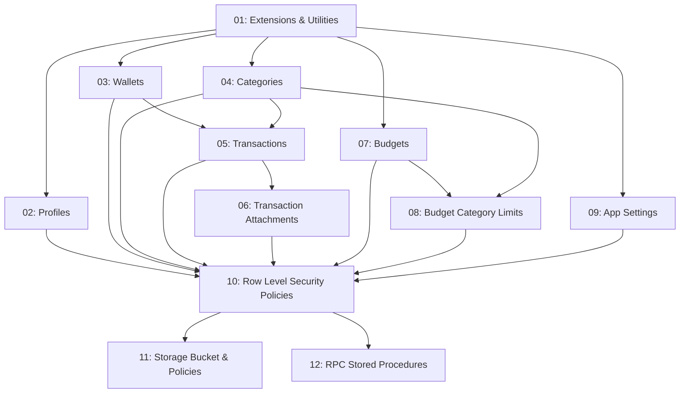

# SCHEMA MAPPING — SQLITE TO SUPABASE POSTGRESQL
**Aplikasi:** MyFinance (Personal Finance Management)  
**Dokumen Referensi:** [DATABASE_AUDIT.md](file:///c:/laragon/www/app-finance/DATABASE_AUDIT.md) & [SUPABASE_MIGRATION_PLAN.md](file:///c:/laragon/www/app-finance/SUPABASE_MIGRATION_PLAN.md)  
**Status:** Disusun Lengkap Berdasarkan Skema Existing

---

## 1. Prinsip Pemetaan (Mapping Principles)

1. **No Breaking Changes:** Struktur entitas domain tidak diubah; semua kolom esensial dipertahankan dengan tipe data yang setara atau lebih presisi di PostgreSQL.
2. **User Ownership:** Menambahkan kolom kepemilikan data `user_id UUID NOT NULL REFERENCES auth.users(id) ON DELETE CASCADE` pada seluruh tabel pengguna.
3. **Kategori Sistem vs Kustom:** Kategori sistem bawaan memiliki `user_id IS NULL` dan `is_system = TRUE`, sedangkan kategori kustom pengguna memiliki `user_id = auth.uid()` dan `is_system = FALSE`.
4. **Presisi Finansial:** Kolom nominal mata uang Rupiah (`opening_balance`, `amount`, `total_limit`, `limit_amount`) menggunakan `BIGINT` di PostgreSQL (setara `INTEGER` di SQLite) dengan constraint nilai `CHECK`.
5. **Waktu & Zona Waktu:** Kolom tanggal ISO-8601 UTC di SQLite (`TEXT`) dipetakan menjadi `TIMESTAMPTZ` di PostgreSQL dengan trigger otomatis `handle_updated_at()`.

---

## 2. Pemetaan Tabel Detail (Detailed Table Mappings)

### 2.1 `wallets`
Menyimpan akun dompet dan rekening perbankan pengguna.

| Kolom SQLite (Drift) | Tipe SQLite | Kolom PostgreSQL | Tipe PostgreSQL | Nullable | Default | Keterangan & Constraint |
| :--- | :--- | :--- | :--- | :--- | :--- | :--- |
| `id` | `TEXT` | `id` | `UUID` | No | `gen_random_uuid()` | Primary Key |
| *(Baru)* | - | `user_id` | `UUID` | No | - | Foreign Key ke `auth.users(id) ON DELETE CASCADE` |
| `name` | `TEXT` | `name` | `VARCHAR(100)` | No | - | Nama akun dompet |
| `type` | `TEXT` | `type` | `VARCHAR(20)` | No | - | `CHECK (type IN ('cash', 'bank', 'e_wallet', 'other'))` |
| `opening_balance` | `INTEGER` | `opening_balance` | `BIGINT` | No | `0` | Saldo awal buku kas (Rupiah) |
| `opening_date` | `TEXT` | `opening_date` | `TIMESTAMPTZ` | No | `NOW()` | Waktu penetapan saldo awal |
| `currency_code` | `TEXT` | `currency_code` | `VARCHAR(3)` | No | `'IDR'` | Kode mata uang standar ISO |
| `icon_key` | `TEXT` | `icon_key` | `VARCHAR(50)` | Yes | `NULL` | Identifier ikon visual |
| `color_hex` | `TEXT` | `color_hex` | `VARCHAR(20)` | Yes | `NULL` | Kode hex warna aksen |
| `is_archived` | `INTEGER` | `is_archived` | `BOOLEAN` | No | `FALSE` | Status arsip dompet cadangan |
| `created_at` | `TEXT` | `created_at` | `TIMESTAMPTZ` | No | `NOW()` | Waktu pembuatan baris data |
| `updated_at` | `TEXT` | `updated_at` | `TIMESTAMPTZ` | No | `NOW()` | Diperbarui via trigger `tr_wallets_updated_at` |

- **Indeks Tambahan:** `idx_wallets_user_id (user_id)`, `idx_wallets_user_archived (user_id, is_archived)`.

---

### 2.2 `categories`
Menyimpan kategori transaksi (sistem global dan kustom per user).

| Kolom SQLite (Drift) | Tipe SQLite | Kolom PostgreSQL | Tipe PostgreSQL | Nullable | Default | Keterangan & Constraint |
| :--- | :--- | :--- | :--- | :--- | :--- | :--- |
| `id` | `TEXT` | `id` | `TEXT` | No | - | Primary Key (mendukung `cat-*` dan UUID) |
| *(Baru)* | - | `user_id` | `UUID` | Yes | `NULL` | FK ke `auth.users(id)`. `NULL` jika kategori sistem |
| `name` | `TEXT` | `name` | `VARCHAR(100)` | No | - | Nama pos kategori |
| `type` | `TEXT` | `type` | `VARCHAR(20)` | No | - | `CHECK (type IN ('income', 'expense'))` |
| `icon_key` | `TEXT` | `icon_key` | `VARCHAR(50)` | Yes | `NULL` | Identifier ikon visual |
| `color_hex` | `TEXT` | `color_hex` | `VARCHAR(20)` | Yes | `NULL` | Kode hex warna aksen |
| `is_system` | `INTEGER` | `is_system` | `BOOLEAN` | No | `FALSE` | Penanda kategori bawaan sistem |
| `is_archived` | `INTEGER` | `is_archived` | `BOOLEAN` | No | `FALSE` | Status arsip kategori kustom |
| `sort_order` | `INTEGER` | `sort_order` | `INT` | No | `0` | Urutan penyusunan antarmuka |
| `created_at` | - | `created_at` | `TIMESTAMPTZ` | No | `NOW()` | Waktu pembuatan |
| `updated_at` | - | `updated_at` | `TIMESTAMPTZ` | No | `NOW()` | Diperbarui via trigger `tr_categories_updated_at` |

- **Constraint Integritas Kategori:**
  `CONSTRAINT chk_categories_user_or_system CHECK ((is_system = TRUE AND user_id IS NULL) OR (is_system = FALSE AND user_id IS NOT NULL))`
- **Indeks Tambahan:** `idx_categories_user_type (user_id, type, is_archived)`.

---

### 2.3 `transactions`
Menyimpan mutasi buku besar pemasukan, pengeluaran, dan transfer internal.

| Kolom SQLite (Drift) | Tipe SQLite | Kolom PostgreSQL | Tipe PostgreSQL | Nullable | Default | Keterangan & Constraint |
| :--- | :--- | :--- | :--- | :--- | :--- | :--- |
| `id` | `TEXT` | `id` | `UUID` | No | `gen_random_uuid()` | Primary Key |
| *(Baru)* | - | `user_id` | `UUID` | No | - | Foreign Key ke `auth.users(id) ON DELETE CASCADE` |
| `type` | `TEXT` | `type` | `VARCHAR(20)` | No | - | `CHECK (type IN ('income', 'expense', 'transfer'))` |
| `amount` | `INTEGER` | `amount` | `BIGINT` | No | - | `CHECK (amount > 0)` (Rupiah) |
| `occurred_at` | `TEXT` | `occurred_at` | `TIMESTAMPTZ` | No | - | Waktu aktual kejadian transaksi |
| `wallet_id` | `TEXT` | `wallet_id` | `UUID` | Yes | `NULL` | FK ke `wallets(id) ON DELETE RESTRICT` (sumber) |
| `destination_wallet_id`| `TEXT` | `destination_wallet_id`| `UUID` | Yes | `NULL` | FK ke `wallets(id) ON DELETE RESTRICT` (tujuan transfer) |
| `category_id` | `TEXT` | `category_id` | `TEXT` | Yes | `NULL` | FK ke `categories(id) ON DELETE RESTRICT` |
| `merchant` | `TEXT` | `merchant` | `TEXT` | Yes | `NULL` | Toko / pihak rekanan transaksi |
| `description` | `TEXT` | `description` | `TEXT` | Yes | `NULL` | Ringkasan deskripsi transaksi |
| `notes` | `TEXT` | `notes` | `TEXT` | Yes | `NULL` | Catatan rinci / rincian item struk |
| `source` | `TEXT` | `source` | `VARCHAR(30)` | No | `'manual'` | `CHECK (source IN ('manual', 'receipt_scan', 'recurring'))` |
| `status` | `TEXT` | `status` | `VARCHAR(20)` | No | `'confirmed'`| `CHECK (status IN ('confirmed', 'voided'))` |
| `created_at` | `TEXT` | `created_at` | `TIMESTAMPTZ` | No | `NOW()` | Waktu pencatatan di sistem |
| `updated_at` | `TEXT` | `updated_at` | `TIMESTAMPTZ` | No | `NOW()` | Diperbarui via trigger `tr_transactions_updated_at` |

- **Integritas Relasi Transfer:**
  `CONSTRAINT chk_transactions_transfer_wallets CHECK ((type = 'transfer' AND wallet_id IS NOT NULL AND destination_wallet_id IS NOT NULL AND wallet_id <> destination_wallet_id) OR (type <> 'transfer'))`
- **Integritas Relasi Income/Expense:**
  `CONSTRAINT chk_transactions_income_expense_wallets CHECK ((type IN ('income', 'expense') AND wallet_id IS NOT NULL AND destination_wallet_id IS NULL AND category_id IS NOT NULL) OR (type = 'transfer'))`
- **Indeks Tambahan:**
  - `idx_transactions_user_occurred (user_id, occurred_at DESC)`
  - `idx_transactions_user_type_status (user_id, type, status, occurred_at DESC)`
  - `idx_transactions_user_wallet (user_id, wallet_id, occurred_at DESC)`
  - `idx_transactions_user_dest_wallet (user_id, destination_wallet_id, occurred_at DESC)`
  - `idx_transactions_user_category (user_id, category_id, occurred_at DESC)`

---

### 2.4 `transaction_attachments`
Menyimpan tautan berkas foto struk belanja yang terunggah di Supabase Storage.

| Kolom SQLite (Drift) | Tipe SQLite | Kolom PostgreSQL | Tipe PostgreSQL | Nullable | Default | Keterangan & Constraint |
| :--- | :--- | :--- | :--- | :--- | :--- | :--- |
| `id` | `TEXT` | `id` | `UUID` | No | `gen_random_uuid()` | Primary Key |
| *(Baru)* | - | `user_id` | `UUID` | No | - | Foreign Key ke `auth.users(id) ON DELETE CASCADE` |
| `transaction_id` | `TEXT` | `transaction_id` | `UUID` | No | - | FK ke `transactions(id) ON DELETE CASCADE` |
| `local_path` | `TEXT` | `storage_path` | `TEXT` | No | - | Path di Storage: `receipts/<user_id>/<id>.jpg` |
| `mime_type` | `TEXT` | `mime_type` | `VARCHAR(50)` | No | `'image/jpeg'` | Tipe MIME media gambar |
| `file_size` | `INTEGER` | `file_size` | `INT` | No | - | `CHECK (file_size > 0)` (ukuran dalam bytes) |
| `created_at` | `TEXT` | `created_at` | `TIMESTAMPTZ` | No | `NOW()` | Waktu upload |

- **Indeks Tambahan:** `idx_attachments_user_tx (user_id, transaction_id)`.

---

### 2.5 `budgets`
Menyimpan master anggaran bulanan pengguna per bulan unik (`month_key`).

| Kolom SQLite (Drift) | Tipe SQLite | Kolom PostgreSQL | Tipe PostgreSQL | Nullable | Default | Keterangan & Constraint |
| :--- | :--- | :--- | :--- | :--- | :--- | :--- |
| `id` | `TEXT` | `id` | `UUID` | No | `gen_random_uuid()` | Primary Key |
| *(Baru)* | - | `user_id` | `UUID` | No | - | Foreign Key ke `auth.users(id) ON DELETE CASCADE` |
| `month_key` | `TEXT` | `month_key` | `VARCHAR(7)` | No | - | Format `YYYY-MM` (`CHECK (month_key ~ '^[0-9]{4}-[0-9]{2}$')`) |
| `total_limit` | `INTEGER` | `total_limit` | `BIGINT` | No | - | `CHECK (total_limit >= 0)` (Plafon total Rupiah) |
| `alert_thresholds` | `TEXT` | `alert_thresholds` | `JSONB` | No | `'[75, 90, 100]'` | Array persentase notifikasi peringatan |
| `carry_over_enabled`| `INTEGER` | `carry_over_enabled`| `BOOLEAN` | No | `FALSE` | Fitur sisa anggaran bergulir |
| `notes` | `TEXT` | `notes` | `TEXT` | Yes | `NULL` | Catatan rencana anggaran bulanan |
| `created_at` | `TEXT` | `created_at` | `TIMESTAMPTZ` | No | `NOW()` | Waktu pembuatan |
| `updated_at` | `TEXT` | `updated_at` | `TIMESTAMPTZ` | No | `NOW()` | Diperbarui via trigger `tr_budgets_updated_at` |

- **Constraint Unik:** `CONSTRAINT uq_budgets_user_month UNIQUE (user_id, month_key)`.
- **Indeks Tambahan:** `idx_budgets_user_month (user_id, month_key)`.

---

### 2.6 `budget_category_limits`
Menyimpan batas alokasi anggaran per pos kategori di bawah anggaran bulanan master.

| Kolom SQLite (Drift) | Tipe SQLite | Kolom PostgreSQL | Tipe PostgreSQL | Nullable | Default | Keterangan & Constraint |
| :--- | :--- | :--- | :--- | :--- | :--- | :--- |
| `id` | `TEXT` | `id` | `UUID` | No | `gen_random_uuid()` | Primary Key |
| *(Baru)* | - | `user_id` | `UUID` | No | - | Foreign Key ke `auth.users(id) ON DELETE CASCADE` |
| `budget_id` | `TEXT` | `budget_id` | `UUID` | No | - | FK ke `budgets(id) ON DELETE CASCADE` |
| `category_id` | `TEXT` | `category_id` | `TEXT` | No | - | FK ke `categories(id) ON DELETE RESTRICT` |
| `limit_amount` | `INTEGER` | `limit_amount` | `BIGINT` | No | - | `CHECK (limit_amount >= 0)` (Plafon kategori) |
| `created_at` | `TEXT` | `created_at` | `TIMESTAMPTZ` | No | `NOW()` | Waktu pembuatan |

- **Constraint Unik:** `CONSTRAINT uq_budget_cat_limits UNIQUE (budget_id, category_id)`.
- **Indeks Tambahan:** `idx_budget_limits_user_budget (user_id, budget_id)`.

---

### 2.7 `app_settings`
Menyimpan preferensi personal dan status keamanan per pengguna.

| Kolom SQLite (Drift) | Tipe SQLite | Kolom PostgreSQL | Tipe PostgreSQL | Nullable | Default | Keterangan & Constraint |
| :--- | :--- | :--- | :--- | :--- | :--- | :--- |
| *(Baru)* | - | `user_id` | `UUID` | No | - | Foreign Key ke `auth.users(id) ON DELETE CASCADE` |
| `key` | `TEXT` | `key` | `VARCHAR(100)` | No | - | Primary Key Composite 1 |
| `value` | `TEXT` | `value` | `TEXT` | No | - | Nilai pengaturan (string/json) |
| `updated_at` | `TEXT` | `updated_at` | `TIMESTAMPTZ` | No | `NOW()` | Waktu pembaruan terakhir |

- **Primary Key Composite:** `PRIMARY KEY (user_id, key)`.

---

### 2.8 `profiles` *(Tabel Ekstensi Identitas Baru)*
Menghubungkan akun `auth.users` dengan atribut dasar pengguna di level aplikasi.

| Kolom PostgreSQL | Tipe Data | Nullable | Default | Keterangan |
| :--- | :--- | :--- | :--- | :--- |
| `id` | `UUID` | No | - | Primary Key & FK ke `auth.users(id) ON DELETE CASCADE` |
| `email` | `TEXT` | Yes | `NULL` | Alamat surel pengguna |
| `currency_code` | `VARCHAR(3)` | No | `'IDR'` | Mata uang primer profil |
| `theme_mode` | `VARCHAR(10)` | No | `'system'` | Preferensi tema (`system`, `light`, `dark`) |
| `created_at` | `TIMESTAMPTZ` | No | `NOW()` | Waktu pendaftaran |
| `updated_at` | `TIMESTAMPTZ` | No | `NOW()` | Diperbarui via trigger `tr_profiles_updated_at` |

---

## 3. Urutan Eksekusi Migrasi (Migration Sequence)

Urutan eksekusi berkas migrasi disusun secara ketat berdasarkan grafik dependensi Foreign Key:

1. **`20261123180001_create_extensions_and_utilities.sql`**: Ekstensi `uuid-ossp` dan trigger `handle_updated_at()`.
2. **`20261123180002_create_profiles_table.sql`**: Tabel profil pengguna terikat `auth.users`.
3. **`20261123180003_create_wallets_table.sql`**: Tabel akun dompet keuangan.
4. **`20261123180004_create_categories_table.sql`**: Tabel kategori dan seed 11 kategori sistem bawaan.
5. **`20261123180005_create_transactions_table.sql`**: Tabel transaksi dengan FK ke wallets dan categories.
6. **`20261123180006_create_transaction_attachments_table.sql`**: Tabel lampiran struk dengan FK cascade ke transaksi.
7. **`20261123180007_create_budgets_table.sql`**: Tabel master anggaran bulanan.
8. **`20261123180008_create_budget_category_limits_table.sql`**: Tabel alokasi kategori dengan FK cascade ke budgets dan restrict ke categories.
9. **`20261123180009_create_app_settings_table.sql`**: Tabel key-value preferensi per user.
10. **`20261123180010_create_row_level_security_policies.sql`**: RLS diaktifkan di seluruh 8 tabel dengan kebijakan CRUD terisolasi per `auth.uid()`.
11. **`20261123180011_create_storage_bucket_and_policies.sql`**: Konfigurasi bucket privat `receipts` dan RLS storage.
12. **`20261123180012_create_rpc_functions.sql`**: Database Functions `save_budget_with_limits` dan `void_transaction` untuk integritas transaksi atomik.
