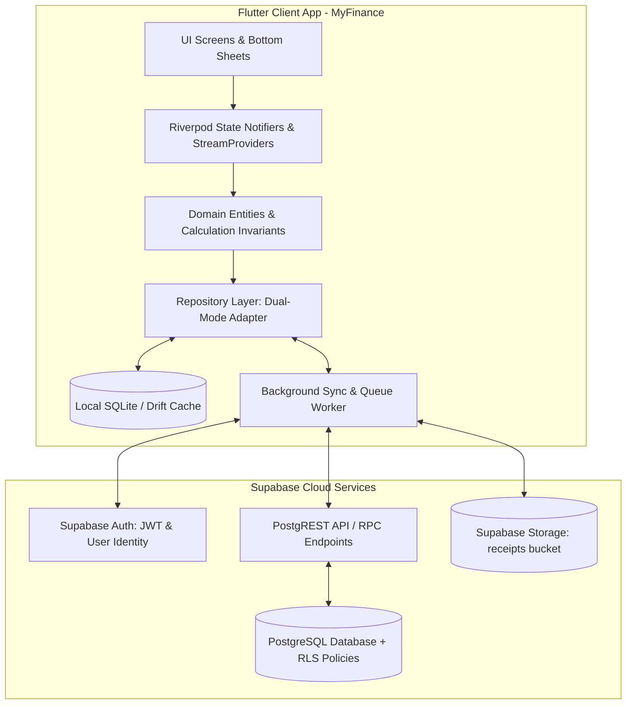

# SUPABASE MIGRATION PLAN — MYFINANCE FLUTTER APPLICATION
**Tanggal Rencana:** 23 November 2026  
**Status Rencana:** Proposed & Designed (Siap Divalidasi)  
**Tujuan Arsitektur:** Mentransisikan basis data MyFinance dari SQLite local-device menjadi Supabase Cloud PostgreSQL, dengan isolasi data terautentikasi (Row Level Security / RLS), sinkronisasi penyimpanan gambar struk (Supabase Storage), serta mempertahankan ketahanan offline tanpa merusak fitur existing.

---

## 1. Ringkasan Arsitektur Target (Target Architecture)

Arsitektur target mengadopsi pola **Hybrid Cloud with Local Cache (Offline-First)** yang mempertahankan performa instan (0–2ms) SQLite lokal sekaligus memanfaatkan keandalan cloud PostgreSQL:



### Prinsip Utama Arsitektur:
1. **Supabase PostgreSQL** berperan sebagai *Single Source of Truth* di cloud.
2. **Supabase Auth** menyediakan identitas pengguna (`auth.users`), sesi token JWT, dan pemulihan akun.
3. **Row Level Security (RLS)** menjamin isolasi data finansial secara mutlak di level engine basis data.
4. **SQLite (Drift) Tetap Dipertahankan** sebagai cache lokal, penopang reaktivitas 60 FPS (Drift Streams), dan jaminan aplikasi tetap dapat mencatat transaksi saat tidak ada koneksi internet (offline).
5. **Supabase Storage** menyimpan berkas gambar struk terenkripsi dengan akses terbatas per `user_id`.

---

## 2. Rencana Autentikasi & Identitas Pengguna (Authentication Plan)

### 2.1 Mekanisme Masuk (Authentication Flow)
Aplikasi saat ini tidak memiliki sistem akun login (pengguna langsung menggunakan aplikasi). Untuk memberikan transisi yang mulus (*frictionless*):
- **Tahap Awal (Seamless / Anonymous Auth):**
  - Saat aplikasi pertama kali dibuka dengan koneksi internet, aplikasi memanggil `supabase.auth.signInAnonymously()`.
  - Pengguna langsung mendapatkan `UUID` unik tanpa dipaksa mengisi form registrasi atau password.
  - Seluruh data lokal langsung diasosiasikan dengan akun anonim tersebut.
- **Tahap Peningkatan Akun (Link to Permanent Account):**
  - Pada menu **Pengaturan > Sinkronisasi Cloud**, pengguna dapat menautkan akun anonim ke akun permanen melalui:
    - **Email + Kata Sandi / Magic Link (OTP)**
    - **Sign in with Apple (Native iOS HIG)**
    - **Google Sign-In**
  - Fungsi: `supabase.auth.linkIdentity(...)`. Dengan demikian, data transaksi tidak akan hilang saat pengguna berganti perangkat.

### 2.2 Pengelolaan Sesi & Token
- SDK: `supabase_flutter: ^2.x`.
- Token JWT disimpan secara aman di iOS Keychain / Android EncryptedSharedPreferences (bawaan plugin `supabase_flutter`).
- Sesi ditangkap secara reaktif melalui `supabase.auth.onAuthStateChange` dan disediakan ke Riverpod via `authStateProvider`.

---

## 3. Pemetaan Skema Supabase PostgreSQL (Schema Mapping & DDL)

Seluruh tipe data SQLite dipetakan ke tipe data native PostgreSQL berkinerja tinggi. Ditambahkan kolom `user_id UUID NOT NULL REFERENCES auth.users(id) ON DELETE CASCADE` pada setiap tabel:

```sql
-- ============================================================================
-- EKSTENSI & UTILITAS
-- ============================================================================
CREATE EXTENSION IF NOT EXISTS "uuid-ossp";

-- Fungsi otomatisasi pembaruan updated_at
CREATE OR REPLACE FUNCTION public.handle_updated_at()
RETURNS TRIGGER AS $$
BEGIN
    NEW.updated_at = NOW();
    RETURN NEW;
END;
$$ LANGUAGE plpgsql;

-- ============================================================================
-- 1. TABEL PROFILES (Ekstensi Pengguna)
-- ============================================================================
CREATE TABLE public.profiles (
    id UUID PRIMARY KEY REFERENCES auth.users(id) ON DELETE CASCADE,
    email TEXT,
    currency_code VARCHAR(3) NOT NULL DEFAULT 'IDR',
    theme_mode VARCHAR(10) NOT NULL DEFAULT 'system',
    created_at TIMESTAMPTZ NOT NULL DEFAULT NOW(),
    updated_at TIMESTAMPTZ NOT NULL DEFAULT NOW()
);

CREATE TRIGGER tr_profiles_updated_at
    BEFORE UPDATE ON public.profiles
    FOR EACH ROW EXECUTE FUNCTION public.handle_updated_at();

-- ============================================================================
-- 2. TABEL WALLETS
-- ============================================================================
CREATE TABLE public.wallets (
    id UUID PRIMARY KEY DEFAULT gen_random_uuid(),
    user_id UUID NOT NULL REFERENCES auth.users(id) ON DELETE CASCADE,
    name VARCHAR(100) NOT NULL,
    type VARCHAR(20) NOT NULL CHECK (type IN ('cash', 'bank', 'e_wallet', 'other')),
    opening_balance BIGINT NOT NULL DEFAULT 0,
    opening_date TIMESTAMPTZ NOT NULL DEFAULT NOW(),
    currency_code VARCHAR(3) NOT NULL DEFAULT 'IDR',
    icon_key VARCHAR(50),
    color_hex VARCHAR(20),
    is_archived BOOLEAN NOT NULL DEFAULT FALSE,
    created_at TIMESTAMPTZ NOT NULL DEFAULT NOW(),
    updated_at TIMESTAMPTZ NOT NULL DEFAULT NOW()
);

CREATE INDEX idx_wallets_user_id ON public.wallets(user_id);
CREATE INDEX idx_wallets_user_archived ON public.wallets(user_id, is_archived);

CREATE TRIGGER tr_wallets_updated_at
    BEFORE UPDATE ON public.wallets
    FOR EACH ROW EXECUTE FUNCTION public.handle_updated_at();

-- ============================================================================
-- 3. TABEL CATEGORIES
-- ============================================================================
CREATE TABLE public.categories (
    id TEXT PRIMARY KEY, -- Mendukung ID sistem seperti 'cat-exp-food' atau UUID kustom
    user_id UUID REFERENCES auth.users(id) ON DELETE CASCADE, -- NULL untuk kategori bawaan sistem global
    name VARCHAR(100) NOT NULL,
    type VARCHAR(20) NOT NULL CHECK (type IN ('income', 'expense')),
    icon_key VARCHAR(50),
    color_hex VARCHAR(20),
    is_system BOOLEAN NOT NULL DEFAULT FALSE,
    is_archived BOOLEAN NOT NULL DEFAULT FALSE,
    sort_order INT NOT NULL DEFAULT 0,
    created_at TIMESTAMPTZ NOT NULL DEFAULT NOW(),
    updated_at TIMESTAMPTZ NOT NULL DEFAULT NOW()
);

CREATE INDEX idx_categories_user_type ON public.categories(user_id, type, is_archived);

CREATE TRIGGER tr_categories_updated_at
    BEFORE UPDATE ON public.categories
    FOR EACH ROW EXECUTE FUNCTION public.handle_updated_at();

-- ============================================================================
-- 4. TABEL TRANSACTIONS
-- ============================================================================
CREATE TABLE public.transactions (
    id UUID PRIMARY KEY DEFAULT gen_random_uuid(),
    user_id UUID NOT NULL REFERENCES auth.users(id) ON DELETE CASCADE,
    type VARCHAR(20) NOT NULL CHECK (type IN ('income', 'expense', 'transfer')),
    amount BIGINT NOT NULL CHECK (amount > 0),
    occurred_at TIMESTAMPTZ NOT NULL,
    wallet_id UUID REFERENCES public.wallets(id) ON DELETE RESTRICT,
    destination_wallet_id UUID REFERENCES public.wallets(id) ON DELETE RESTRICT,
    category_id TEXT REFERENCES public.categories(id) ON DELETE RESTRICT,
    merchant TEXT,
    description TEXT,
    notes TEXT,
    source VARCHAR(30) NOT NULL DEFAULT 'manual' CHECK (source IN ('manual', 'receipt_scan', 'recurring')),
    status VARCHAR(20) NOT NULL DEFAULT 'confirmed' CHECK (status IN ('confirmed', 'voided')),
    created_at TIMESTAMPTZ NOT NULL DEFAULT NOW(),
    updated_at TIMESTAMPTZ NOT NULL DEFAULT NOW(),
    CONSTRAINT chk_transactions_transfer_wallets CHECK (
        (type = 'transfer' AND destination_wallet_id IS NOT NULL AND wallet_id <> destination_wallet_id) OR
        (type <> 'transfer')
    )
);

CREATE INDEX idx_transactions_user_occurred ON public.transactions(user_id, occurred_at DESC);
CREATE INDEX idx_transactions_user_type_status ON public.transactions(user_id, type, status, occurred_at DESC);
CREATE INDEX idx_transactions_user_wallet ON public.transactions(user_id, wallet_id, occurred_at DESC);
CREATE INDEX idx_transactions_user_dest_wallet ON public.transactions(user_id, destination_wallet_id, occurred_at DESC);
CREATE INDEX idx_transactions_user_category ON public.transactions(user_id, category_id, occurred_at DESC);

CREATE TRIGGER tr_transactions_updated_at
    BEFORE UPDATE ON public.transactions
    FOR EACH ROW EXECUTE FUNCTION public.handle_updated_at();

-- ============================================================================
-- 5. TABEL TRANSACTION_ATTACHMENTS
-- ============================================================================
CREATE TABLE public.transaction_attachments (
    id UUID PRIMARY KEY DEFAULT gen_random_uuid(),
    user_id UUID NOT NULL REFERENCES auth.users(id) ON DELETE CASCADE,
    transaction_id UUID NOT NULL REFERENCES public.transactions(id) ON DELETE CASCADE,
    storage_path TEXT NOT NULL, -- Path di Supabase Storage (cth: 'receipts/<user_id>/<id>.jpg')
    mime_type VARCHAR(50) NOT NULL DEFAULT 'image/jpeg',
    file_size INT NOT NULL,
    created_at TIMESTAMPTZ NOT NULL DEFAULT NOW()
);

CREATE INDEX idx_attachments_user_tx ON public.transaction_attachments(user_id, transaction_id);

-- ============================================================================
-- 6. TABEL BUDGETS
-- ============================================================================
CREATE TABLE public.budgets (
    id UUID PRIMARY KEY DEFAULT gen_random_uuid(),
    user_id UUID NOT NULL REFERENCES auth.users(id) ON DELETE CASCADE,
    month_key VARCHAR(7) NOT NULL CHECK (month_key ~ '^[0-9]{4}-[0-9]{2}$'), -- Format YYYY-MM
    total_limit BIGINT NOT NULL CHECK (total_limit >= 0),
    alert_thresholds JSONB NOT NULL DEFAULT '[75, 90, 100]'::jsonb,
    carry_over_enabled BOOLEAN NOT NULL DEFAULT FALSE,
    notes TEXT,
    created_at TIMESTAMPTZ NOT NULL DEFAULT NOW(),
    updated_at TIMESTAMPTZ NOT NULL DEFAULT NOW(),
    CONSTRAINT uq_budgets_user_month UNIQUE (user_id, month_key)
);

CREATE INDEX idx_budgets_user_month ON public.budgets(user_id, month_key);

CREATE TRIGGER tr_budgets_updated_at
    BEFORE UPDATE ON public.budgets
    FOR EACH ROW EXECUTE FUNCTION public.handle_updated_at();

-- ============================================================================
-- 7. TABEL BUDGET_CATEGORY_LIMITS
-- ============================================================================
CREATE TABLE public.budget_category_limits (
    id UUID PRIMARY KEY DEFAULT gen_random_uuid(),
    user_id UUID NOT NULL REFERENCES auth.users(id) ON DELETE CASCADE,
    budget_id UUID NOT NULL REFERENCES public.budgets(id) ON DELETE CASCADE,
    category_id TEXT NOT NULL REFERENCES public.categories(id) ON DELETE RESTRICT,
    limit_amount BIGINT NOT NULL CHECK (limit_amount >= 0),
    created_at TIMESTAMPTZ NOT NULL DEFAULT NOW(),
    CONSTRAINT uq_budget_cat_limits UNIQUE (budget_id, category_id)
);

CREATE INDEX idx_budget_limits_user_budget ON public.budget_category_limits(user_id, budget_id);

-- ============================================================================
-- 8. TABEL APP_SETTINGS
-- ============================================================================
CREATE TABLE public.app_settings (
    user_id UUID NOT NULL REFERENCES auth.users(id) ON DELETE CASCADE,
    key VARCHAR(100) NOT NULL,
    value TEXT NOT NULL,
    updated_at TIMESTAMPTZ NOT NULL DEFAULT NOW(),
    PRIMARY KEY (user_id, key)
);
```

---

## 4. Kebijakan Keamanan Akses Data (Row Level Security / RLS Strategy)

Setiap tabel diwajibkan mengaktifkan RLS untuk mengisolasi data antar pengguna secara mutlak.

```sql
-- Aktifkan RLS di seluruh tabel
ALTER TABLE public.profiles ENABLE ROW LEVEL SECURITY;
ALTER TABLE public.wallets ENABLE ROW LEVEL SECURITY;
ALTER TABLE public.categories ENABLE ROW LEVEL SECURITY;
ALTER TABLE public.transactions ENABLE ROW LEVEL SECURITY;
ALTER TABLE public.transaction_attachments ENABLE ROW LEVEL SECURITY;
ALTER TABLE public.budgets ENABLE ROW LEVEL SECURITY;
ALTER TABLE public.budget_category_limits ENABLE ROW LEVEL SECURITY;
ALTER TABLE public.app_settings ENABLE ROW LEVEL SECURITY;

-- 1. Kebijakan profiles
CREATE POLICY "Users can view and manage their own profile"
    ON public.profiles FOR ALL
    USING (auth.uid() = id)
    WITH CHECK (auth.uid() = id);

-- 2. Kebijakan wallets
CREATE POLICY "Users can CRUD their own wallets"
    ON public.wallets FOR ALL
    USING (auth.uid() = user_id)
    WITH CHECK (auth.uid() = user_id);

-- 3. Kebijakan categories
-- User dapat melihat kategori sistem (user_id IS NULL) DAN kategori miliknya sendiri.
CREATE POLICY "Users can view system and their own categories"
    ON public.categories FOR SELECT
    USING (user_id IS NULL OR user_id = auth.uid());

CREATE POLICY "Users can insert their own custom categories"
    ON public.categories FOR INSERT
    WITH CHECK (auth.uid() = user_id AND is_system = FALSE);

CREATE POLICY "Users can update their own custom categories"
    ON public.categories FOR UPDATE
    USING (auth.uid() = user_id AND is_system = FALSE)
    WITH CHECK (auth.uid() = user_id AND is_system = FALSE);

CREATE POLICY "Users can delete their own custom categories"
    ON public.categories FOR DELETE
    USING (auth.uid() = user_id AND is_system = FALSE);

-- 4. Kebijakan transactions
CREATE POLICY "Users can CRUD their own transactions"
    ON public.transactions FOR ALL
    USING (auth.uid() = user_id)
    WITH CHECK (auth.uid() = user_id);

-- 5. Kebijakan transaction_attachments
CREATE POLICY "Users can CRUD their own attachments"
    ON public.transaction_attachments FOR ALL
    USING (auth.uid() = user_id)
    WITH CHECK (auth.uid() = user_id);

-- 6. Kebijakan budgets
CREATE POLICY "Users can CRUD their own budgets"
    ON public.budgets FOR ALL
    USING (auth.uid() = user_id)
    WITH CHECK (auth.uid() = user_id);

-- 7. Kebijakan budget_category_limits
CREATE POLICY "Users can CRUD their own budget limits"
    ON public.budget_category_limits FOR ALL
    USING (auth.uid() = user_id)
    WITH CHECK (auth.uid() = user_id);

-- 8. Kebijakan app_settings
CREATE POLICY "Users can CRUD their own settings"
    ON public.app_settings FOR ALL
    USING (auth.uid() = user_id)
    WITH CHECK (auth.uid() = user_id);
```

---

## 5. Transaksi Atomik Cloud via Database RPC Functions

Operasi multi-tabel yang sebelumnya berjalan dalam `db.transaction()` SQLite digantikan dengan fungsi PostgreSQL Stored Procedure (RPC) yang aman dan atomik:

### 5.1 RPC `save_budget_with_limits`
Menyimpan master anggaran dan seluruh limit kategori dalam satu transaksi atomik di server:
```sql
CREATE OR REPLACE FUNCTION public.save_budget_with_limits(
    p_budget_id UUID,
    p_month_key VARCHAR(7),
    p_total_limit BIGINT,
    p_alert_thresholds JSONB,
    p_carry_over BOOLEAN,
    p_notes TEXT,
    p_limits JSONB -- Array of objects: [{"category_id": "cat-...", "limit_amount": 500000}]
)
RETURNS VOID AS $$
DECLARE
    v_user_id UUID := auth.uid();
    v_item JSONB;
BEGIN
    IF v_user_id IS NULL THEN
        RAISE EXCEPTION 'Not authenticated';
    END IF;

    -- Upsert master budget
    INSERT INTO public.budgets (
        id, user_id, month_key, total_limit, alert_thresholds, carry_over_enabled, notes
    ) VALUES (
        p_budget_id, v_user_id, p_month_key, p_total_limit, p_alert_thresholds, p_carry_over, p_notes
    )
    ON CONFLICT (user_id, month_key) DO UPDATE SET
        total_limit = EXCLUDED.total_limit,
        alert_thresholds = EXCLUDED.alert_thresholds,
        carry_over_enabled = EXCLUDED.carry_over_enabled,
        notes = EXCLUDED.notes,
        updated_at = NOW();

    -- Hapus limit kategori lama untuk budget ini
    DELETE FROM public.budget_category_limits 
    WHERE user_id = v_user_id AND budget_id = p_budget_id;

    -- Insert limit kategori baru
    IF p_limits IS NOT NULL AND jsonb_array_length(p_limits) > 0 THEN
        FOR v_item IN SELECT * FROM jsonb_array_elements(p_limits) LOOP
            INSERT INTO public.budget_category_limits (
                user_id, budget_id, category_id, limit_amount
            ) VALUES (
                v_user_id, p_budget_id, (v_item->>'category_id'), (v_item->>'limit_amount')::BIGINT
            );
        END LOOP;
    END IF;
END;
$$ LANGUAGE plpgsql SECURITY DEFINER;
```

---

## 6. Rencana Penyimpanan Berkas Struk (Supabase Storage Plan)

### 6.1 Konfigurasi Bucket
- **Nama Bucket:** `receipts`
- **Tipe Privasi:** Private (Bukan publik).
- **Maksimal Ukuran File:** 5 MB.
- **Tipe MIME Diizinkan:** `image/jpeg`, `image/png`, `image/webp`.

### 6.2 Struktur Folder & Kebijakan Storage
Berkas disimpan dengan format direktori terisolasi: `receipts/<user_id>/<attachment_id>.jpg`.

```sql
-- Kebijakan Akses Berkas di Supabase Storage
CREATE POLICY "Users can upload their own receipt images"
    ON storage.objects FOR INSERT
    WITH CHECK (
        bucket_id = 'receipts' AND
        (storage.foldername(name))[1] = auth.uid()::text
    );

CREATE POLICY "Users can view their own receipt images"
    ON storage.objects FOR SELECT
    USING (
        bucket_id = 'receipts' AND
        (storage.foldername(name))[1] = auth.uid()::text
    );

CREATE POLICY "Users can delete their own receipt images"
    ON storage.objects FOR DELETE
    USING (
        bucket_id = 'receipts' AND
        (storage.foldername(name))[1] = auth.uid()::text
    );
```

### 6.3 Pengambilan URL Gambar Struk
- Di sisi Flutter client, URL foto struk diambil menggunakan **Signed URL** berbatas waktu (misal: 60 menit) via:
  `supabase.storage.from('receipts').createSignedUrl(storagePath, 3600)`
- Berkas struk yang diunduh disimpan di memory cache (`cached_network_image`) untuk menghemat konsumsi kuota bandwidth.

---

## 7. Rencana Migrasi Lapisan Repositori (Repository Migration Plan)

Karena MyFinance telah mengadopsi Clean Architecture dengan Interface Repositori di domain layer, transisi data source dapat dilakukan tanpa mengubah kode UI / Screen / Riverpod StateNotifiers:

### 7.1 Pola Sinkronisasi Hybrid
Untuk menjamin performa tanpa jeda dan keandalan saat koneksi terputus:
1. **Penyimpanan Lokal Sebagai Write-Through Cache:**
   - Operasi `createTransaction`, `updateWallet`, dsb. tetap menulis ke SQLite lokal seketika (menghasilkan UI responsif 0ms).
   - Sebuah background sync queue mencatat antrean mutasi untuk di-push ke Supabase PostgREST.
2. **Pola Data Source Terpisah:**
   - `WalletLocalDataSource` (Drift DAO existing).
   - `WalletRemoteDataSource` (Supabase Client PostgREST).
   - `WalletRepositoryImpl` mengoordinasikan pembacaan dari cache dan pembaruan berkala dari cloud.

---

## 8. Rencana Migrasi Data Pengguna (Data Migration Plan)

Ketika pengguna beralih dari mode offline ke akun cloud Supabase:

### 8.1 Alur Migrasi Data Otomatis (First-Time Sync Wizard)
1. **Langkah 1 (Dump Data Lokal):**
   - Menggunakan use case yang sudah teruji: [`CreateBackupUseCase`](file:///c:/laragon/www/app-finance/lib/features/backup_restore/domain/usecases/create_backup_usecase.dart).
   - Menghasilkan payload `BackupArchive` dari SQLite lokal yang lengkap beserta relasinya.
2. **Langkah 2 (Pengayaan User ID):**
   - Menambahkan `user_id = supabase.auth.currentUser!.id` ke setiap entitas.
3. **Langkah 3 (Batch Upsert ke Supabase):**
   - Memanggil endpoint RPC cloud `restore_backup_archive(payload)` untuk menyalin seluruh akun dompet, mutasi transaksi, master anggaran, dan preferensi pengaturan dalam satu transaksi.
4. **Langkah 4 (Migrasi Berkas Gambar Struk):**
   - Memindai berkas fisik di folder `<ApplicationDocumentsDirectory>/receipts/`.
   - Mengunggah berkas gambar satu per satu ke Supabase Storage `receipts/<user_id>/<attachment_id>.jpg` dengan mekanisme retry otomatis.
5. **Langkah 5 (Verifikasi Konsistensi):**
   - Memeriksa jumlah baris dan total saldo antara SQLite lokal dan PostgreSQL cloud.
   - Jika valid, tandai flag `initial_cloud_sync_completed = true`.

---

## 9. Strategi Mode Offline & Penanganan Konflik (Offline Strategy)

1. **Prinsip Dasar:** Seluruh fitur pencatatan harian, OCR struk on-device, dan kalkulasi saldo harus tetap dapat digunakan tanpa koneksi internet.
2. **Manajemen Konflik (Conflict Resolution):**
   - Setiap tabel memiliki kolom `updated_at TIMESTAMPTZ`.
   - Menerapkan strategi **Last-Write-Wins (LWW)** berdasarkan stempel waktu UTC tertinggi.
3. **Outbox Pattern:**
   - Tabel `sync_queue` di SQLite lokal mencatat mutasi tertunda (`pending_inserts`, `pending_updates`, `pending_deletes`).
   - `SyncService` mendengarkan status konektivitas jaringan (`connectivity_plus`) dan secara otomatis mengosongkan antrean saat internet kembali tersambung.

---

## 10. Analisis Risiko Keamanan & Mitigasi

| Potensi Risiko | Tingkat Risiko | Dampak | Strategi Mitigasi |
| :--- | :--- | :--- | :--- |
| **Kebocoran Data Antar Pengguna** | Kritis | Pengguna dapat melihat saldo/transaksi orang lain | Wajib menerapkan RLS di 100% tabel PostgreSQL. Verifikasi dengan integration test multi-akun sebelum rilis. |
| **Koneksi Jaringan Lemah / Gagal** | Tinggi | Aplikasi hang saat menyimpan transaksi | Pertahankan write ke SQLite lokal terlebih dahulu (optimistic write), sinkronkan ke cloud secara asinkron. |
| **Penyimpanan Token Session di Client** | Sedang | Pembajakan sesi pengguna | Gunakan Secure Storage bawaan `supabase_flutter` yang memanfaatkan Apple Keychain (iOS) & Keystore (Android). |
| **Kekurangan Kuota Jaringan (Bandwidth Struk)** | Sedang | Pemborosan kuota data saat membuka riwayat | Simpan thumbnail cache di lokal; jangan mengunduh ulang gambar struk jika berkas lokal masih tersedia. |
| **Integritas Multi-Table pada Budgeting** | Tinggi | Data budget dan limit kategori tidak sinkron jika koneksi terputus di tengah jalan | Wajib menggunakan PostgreSQL RPC Function (`save_budget_with_limits`) untuk menjamin transaksi ACID. |

---

## 11. Rencana Pengujian Komprehensif (Testing Plan)

1. **Uji Coba Skema & RLS (Automated SQL Tests):**
   - Buat skrip pgTAP atau integration test untuk menguji 2 akun pengguna (User A dan User B).
   - Pastikan User A **ditolak (HTTP 403 / 0 rows)** saat mencoba membaca, mengedit, atau menghapus dompet, transaksi, maupun berkas storage milik User B.
2. **Uji Coba Perhitungan Saldo (Regression Tests):**
   - Jalankan seluruh unit test finansial: [`wallet_engine_test.dart`](file:///c:/laragon/www/app-finance/test/unit/wallet_engine_test.dart) dan [`edit_wallet_test.dart`](file:///c:/laragon/www/app-finance/test/unit/edit_wallet_test.dart).
   - Pastikan invarian saldo buku besar, transfer internal, dan anggaran bulanan tetap 100% identik dengan hasil SQLite lokal.
3. **Uji Coba Transisi Jaringan (Online-to-Offline Transition):**
   - Catat transaksi saat online -> Putuskan internet (Airplane mode) -> Catat transaksi baru -> Sambungkan kembali -> Verifikasi mutasi terunggah ke Supabase tanpa duplikasi.
4. **Uji Coba Migrasi Data Riil:**
   - Lakukan migrasi pada database lokal yang sudah berisi puluhan transaksi dan verifikasi seluruh baris ter-copy secara sempurna ke cloud.

---

## 12. Strategi Pemulihan & Rollback (Rollback Strategy)

1. **Zero Data-Loss Guarantee:**
   - Basis data SQLite lokal **tidak dihapus sama sekali**.
   - Setiap mutasi cloud tetap disalin ke SQLite lokal sebagai salinan cadangan permanen di perangkat pengguna.
2. **Tombol Fallback Darurat:**
   - Jika Supabase mengalami kendala operasional (downtime/gangguan cloud), sediakan toggle di layar pengaturan: **"Gunakan Mode Lokal Murni"**.
   - Aplikasi dapat beralih kembali menggunakan SQLite lokal secara instan tanpa perlu update aplikasi di App Store / Play Store.
